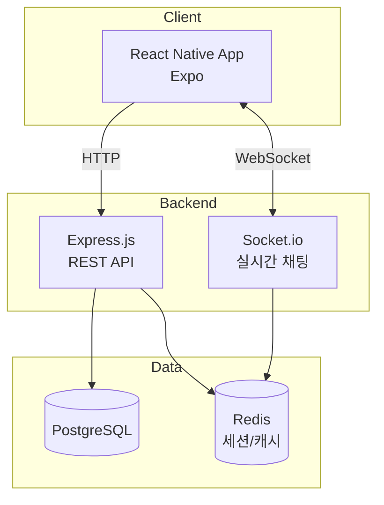
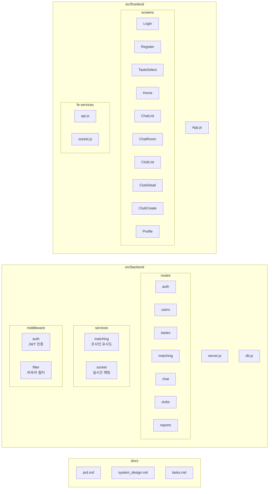

# Orbit 🍽️

취향 기반 소셜 매칭 앱 — 음식 취향이 비슷한 사람들을 연결합니다.

## 기술 스택

| 영역 | 기술 |
|------|------|
| Frontend | React Native (Expo) |
| Backend | Express.js + Socket.io |
| Database | PostgreSQL |
| Cache | Redis |
| Auth | JWT + bcrypt |

## 시스템 아키텍처



## 프로젝트 구조



## API 흐름

```mermaid
sequenceDiagram
    participant U as 사용자
    participant F as Frontend
    participant B as Backend
    participant D as PostgreSQL

    U->>F: 회원가입
    F->>B: POST /api/auth/register
    B->>D: INSERT user
    B-->>F: JWT 토큰

    U->>F: 취향 선택
    F->>B: PUT /api/users/tastes
    B->>D: INSERT user_tastes

    U->>F: 매칭 요청
    F->>B: GET /api/matching
    B->>D: 취향 벡터 조회
    B->>B: 코사인 유사도 계산
    B-->>F: 추천 유저 목록

    U->>F: 채팅 시작
    F->>B: POST /api/chat/rooms
    F<-->B: Socket.io 실시간 메시지
```

## 실행 방법

### 사전 요구사항

- Node.js 18+
- PostgreSQL 16
- Redis

### 1. PostgreSQL 설정

```bash
brew install postgresql@16
brew services start postgresql@16
createdb orbit
```

### 2. 백엔드 실행

```bash
cd src/backend
npm install
cp .env.example .env   # 환경변수 설정
npm run migrate         # DB 마이그레이션
npm run dev             # 개발 서버 시작 (localhost:3000)
```

### 3. 프론트엔드 실행

```bash
cd src/frontend
npm install
npx expo start          # Expo 개발 서버
```

### 환경 변수

`.env.example`을 복사하여 `.env` 파일을 생성하고 값을 설정하세요.
