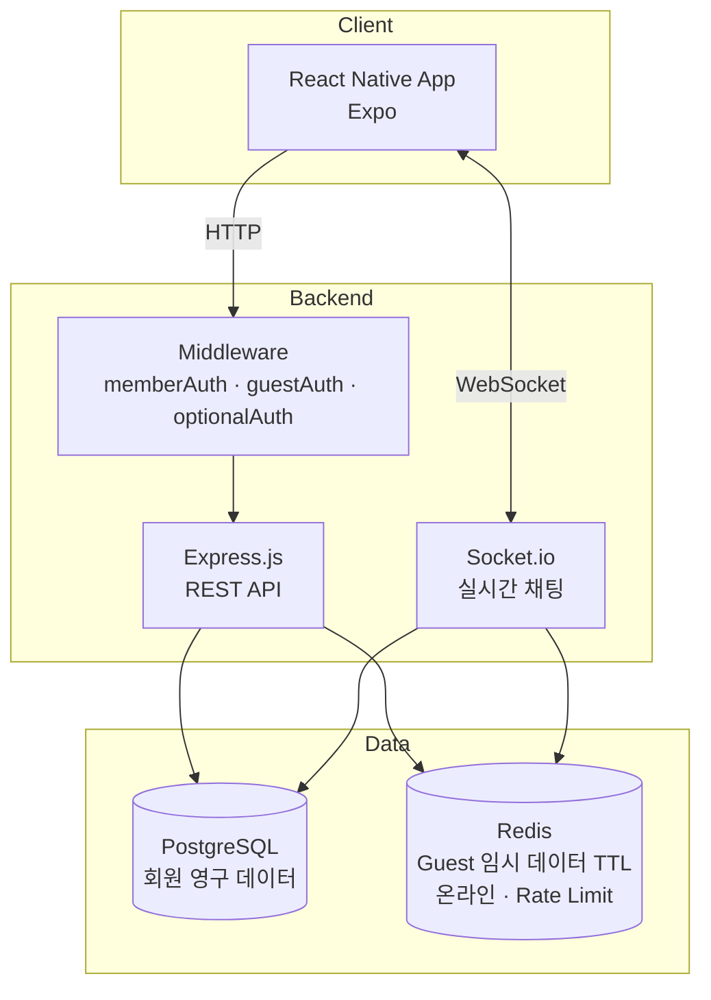
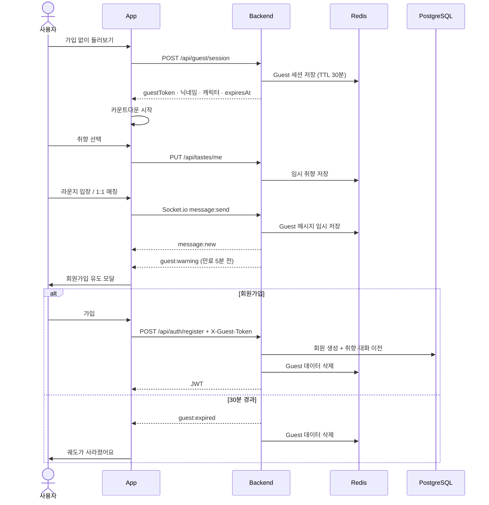
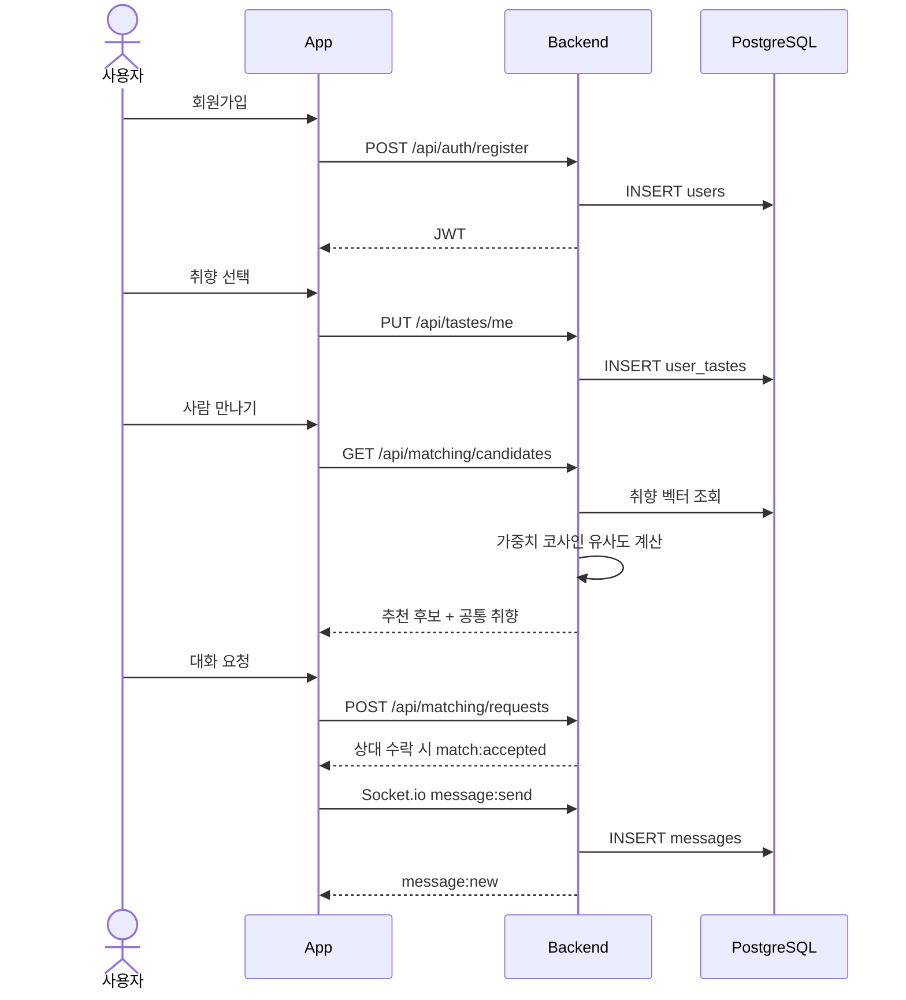

# Orbit 🪐

> **Different lives, shared orbit.**
> Find your people in the same orbit.

각자의 궤도를 돌던 사람들이 **취향**이라는 공통점으로 만나는 곳.
Orbit은 음악·영화·책·여행 등 개인의 취향을 기반으로 비슷한 사람들을 연결하고, **익명으로** 자유롭게 대화할 수 있는 취향 기반 소셜 커뮤니티입니다.

- 사람보다 **취향을 먼저** 발견합니다.
- 실명·사진 대신 **캐릭터와 닉네임**으로 대화합니다.
- 팔로워·순위 없이, 들어오고 싶을 때 들어오고 나가고 싶을 때 나갑니다.
- **가입 없이도** 30분 동안 Orbit을 경험할 수 있습니다.

## 핵심 기능 (MVP)

| 기능 | 설명 |
|---|---|
| 🪐 Orbit Dashboard | 나를 중심으로 취향 행성과 비슷한 사람들이 도는 궤도 시각화 |
| 🎧 취향 시스템 | 7개 카테고리 → 세부 태그 → 중요도(3/2/1점) |
| 💬 취향 라운지 | 관심사별 공개 익명 그룹 채팅 |
| 🤝 1:1 취향 매칭 | 가중치 코사인 유사도로 비슷한 사람과 익명 1:1 대화 |
| ❓ 오늘의 질문 | 매일 하나의 질문, 비슷한 답을 한 사람과 대화 시작 |
| ⏳ Guest Time Attack | 비회원은 30분 동안만 머물고, 시간이 끝나면 궤도가 사라짐 |
| 🛡️ 안전 | 신고·차단, 비속어 필터, 스팸 제한 |

## Member / Guest

| | Member | Guest |
|---|---|---|
| 진입 | 이메일 회원가입 | 가입 없이 바로 입장 |
| 닉네임·캐릭터 | 직접 설정 | 랜덤 자동 발급 |
| 라운지 / 1:1 매칭 | O | O |
| 채팅 기록·취향 | 저장 | 저장 안 함 (Redis 임시) |
| 이용 시간 | 제한 없음 | **30분 (절대 시간)** |
| 가입하면? | - | 진행 중인 대화·취향을 회원 계정으로 이전 |

## 기술 스택

| 영역 | 기술 |
|---|---|
| Client | React Native (Expo) · iOS / Android / Web |
| Backend | Express.js + Socket.io |
| Database | PostgreSQL 16 |
| Cache / 임시 저장 | Redis (Guest 세션·데이터, 온라인 상태, Rate Limit) |
| Auth | JWT + bcrypt (회원) · Guest 세션 토큰 |

## 시스템 아키텍처



## API 흐름

### Guest 입장 → 대화 → 만료 / 가입



### Member 매칭 → 1:1 채팅



## 프로젝트 구조

```
Orbit/
├── src/
│   ├── frontend/     # React Native (Expo)
│   └── backend/      # Express + Socket.io
├── docs/
│   ├── prd.md            # 기획 (확정 사항)
│   ├── system_design.md  # 아키텍처 · 인증 · Guest 세션 · 소켓 이벤트
│   ├── database.md       # DB 설계
│   ├── api_spec.md       # API 명세
│   ├── tasks.md          # 이슈별 작업 범위
│   ├── progress.md       # 진행 현황 · 결정 로그  ← 이어서 작업할 때 여기부터
│   └── deploy.md         # 배포 가이드
├── CONTRIBUTING.md   # 브랜치 · 커밋 · PR 규칙
└── docker-compose.yml
```

> 디렉토리 상세 구조는 [system_design.md §7](docs/system_design.md)을 참고하세요. (#2에서 적용 예정)

## 실행 방법

### 사전 요구사항
- Node.js 18+
- PostgreSQL 16
- Redis 7

### 1. DB · Redis 실행 (Docker)
```bash
docker compose up -d postgres redis
```

또는 Homebrew:
```bash
brew install postgresql@16 redis
brew services start postgresql@16
brew services start redis
createdb orbit
```

### 2. 백엔드
```bash
cd src/backend
npm install
cp .env.example .env
npm run migrate
npm run dev          # http://localhost:3000
```

### 3. 프론트엔드
```bash
cd src/frontend
npm install
npx expo start
```

## 문서 & 진행 상황
- 기획: [docs/prd.md](docs/prd.md)
- 작업 목록: [docs/tasks.md](docs/tasks.md)
- 현재 진행 상황: [docs/progress.md](docs/progress.md)
- 기여 규칙: [CONTRIBUTING.md](CONTRIBUTING.md)
