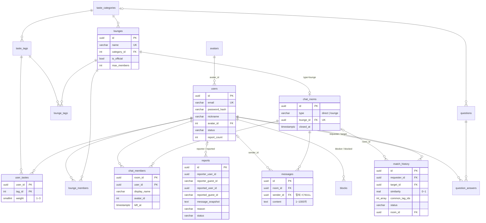

# Orbit Database 설계

> 상태: **확정 (v1, #3)** — 원본: [`src/backend/migrations/001_init.sql`](../src/backend/migrations/001_init.sql)
> - PostgreSQL = **회원(Member) 영구 데이터만**
> - Redis = Guest 세션·임시 데이터 ([system_design.md §4](./system_design.md))

## 1. 설계 원칙
1. **PG에는 회원만 저장한다.** Guest가 포함된 채팅방·라운지 참여·매칭·차단은 Redis에만 두고, Guest가 가입하면(#14) 그때 PG로 INSERT 한다.
   - 예외: `reports`는 Guest 신고를 위해 `reporter_guest_id` / `reported_guest_id`(text) 컬럼을 둔다.
2. **실제 user_id는 클라이언트에 노출하지 않는다.** 1:1 방의 익명 표시 정보(`display_name`, `avatar_id`)는 `chat_members`에 방 단위로 저장한다.
3. PK는 UUID(`gen_random_uuid()`), seed 성격의 테이블(캐릭터·카테고리·태그·질문)은 SERIAL.
4. 시간 컬럼은 `TIMESTAMPTZ NOT NULL DEFAULT now()`.
5. 데이터 무결성은 DB 제약으로 막는다 (자기 자신 차단·매칭 금지, 중복 pending 매칭 금지, 메시지·답변 길이 등).

## 2. ERD



## 3. 테이블 상세

| 테이블 | 용도 | 주요 제약 / 비고 | 관련 이슈 |
|---|---|---|---|
| `avatars` | 기본 캐릭터 6종 (code, emoji, color) | `code` UNIQUE. 커스터마이징은 V2 | #4, #17 |
| `users` | 회원 | `email` UNIQUE, `status` ∈ active/warned/suspended/banned, `avatar_id` 기본 1 | #4 |
| `taste_categories` | 7개 카테고리 | `code` UNIQUE (music, movie, book, food, travel, sports, hobby) | #7 |
| `taste_tags` | 카테고리별 세부 태그 | (category_id, name) UNIQUE | #7 |
| `user_tastes` | 회원 취향 + 중요도 | PK(user_id, tag_id), `weight` 1~3 (3 매우 좋아함 / 2 좋아함 / 1 관심) | #7, #13 |
| `lounges` | 취향 라운지 | `name` UNIQUE, `is_official`(MVP는 전부 true), `created_by`는 V2 | #11 |
| `lounge_tags` | 라운지 대표 태그 | 취향 기반 라운지 추천에 사용 | #8, #11 |
| `lounge_members` | 라운지 참여 (**회원만**) | Guest 참여는 Redis | #11 |
| `chat_rooms` | 채팅방 | `type` direct/lounge, lounge 방은 `lounge_id` 필수·UNIQUE (CHECK) | #10 |
| `chat_members` | 1:1 방 참여자 + 방 단위 익명 표시 | `left_at`이 NULL이면 참여 중 | #10, #13 |
| `messages` | **회원 메시지만** | `content` 1~1000자, 탈퇴 시 `sender_id` NULL | #10 |
| `match_history` | 회원 간 매칭 기록 | 자기 자신 금지, 같은 두 사람 pending 1개만(부분 UNIQUE 인덱스) | #13 |
| `questions` | 오늘의 질문 | `publish_date` 지정 시 그날 노출, 없으면 `sort_order` 순환 | #15 |
| `question_answers` | 질문 답변 (회원) | (question_id, user_id) UNIQUE, 1~300자 | #15 |
| `reports` | 신고 | reporter·reported 각각 user_id 또는 guest_id 중 하나 필수, `message_snapshot` | #16 |
| `blocks` | 회원 간 차단 | 자기 자신 금지 | #16 |
| `schema_migrations` | 적용한 마이그레이션 기록 | `migrations/run.js`가 자동 생성 | - |

## 4. 마이그레이션 · 시드

```bash
cd src/backend
npm run db:setup      # = db:reset + migrate + seed (개발용, 처음 세팅·초기화)

npm run migrate       # 새 .sql 파일만 적용 (schema_migrations로 기록)
npm run seed          # 초기 데이터 입력 — 여러 번 실행해도 안전 (이름/코드 기준 upsert)
npm run db:reset      # public 스키마 삭제 후 재생성 (NODE_ENV=production이면 거부)
```

- 새 스키마 변경은 `002_xxx.sql`처럼 **새 파일을 추가**한다. 이미 적용된 파일은 수정하지 않는다.
- 시드 데이터 원본: [`src/backend/seeds/data.js`](../src/backend/seeds/data.js)
  - 캐릭터 6 · 카테고리 7 · 태그 62 · 라운지 7(+라운지 채팅방 7) · 오늘의 질문 30

## 5. 이전 스키마(TasteMate)에서 바뀐 점

| 이전 | 현재 |
|---|---|
| `taste_options` (+ `image_url`) | `taste_tags` + `user_tastes.weight` (이미지는 제거) |
| `clubs`, `club_members`(role) | `lounges`, `lounge_members`, `lounge_tags` |
| `matches`(user1/user2, similarity_score) | `match_history`(requester/target, similarity 0~1, common_tag_ids, room_id) |
| `chat_rooms.match_id`, `club_id` | `chat_rooms.lounge_id`, 1:1 참여자는 `chat_members` |
| `messages.chat_room_id`, `type`, `guest_session_id` | `messages.room_id`, 텍스트만, Guest 메시지 없음 |
| users의 `is_guest`, `guest_expires_at`, `profile_image`, `bio` | 제거 — Guest는 Redis, 프로필은 `avatar_id` |
| (없음) | `avatars`, `questions`, `question_answers`, `schema_migrations` |

## 6. Redis 키
[system_design.md §4-1](./system_design.md) 참고
