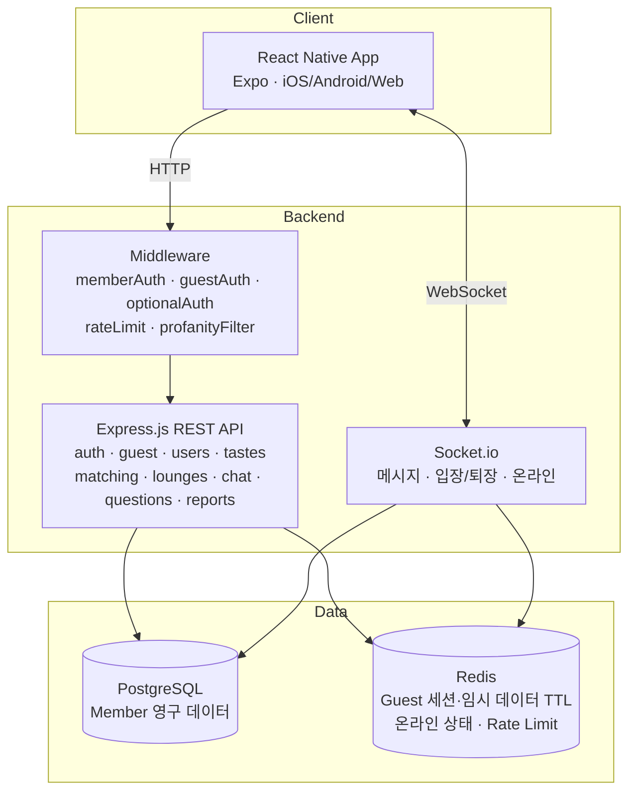
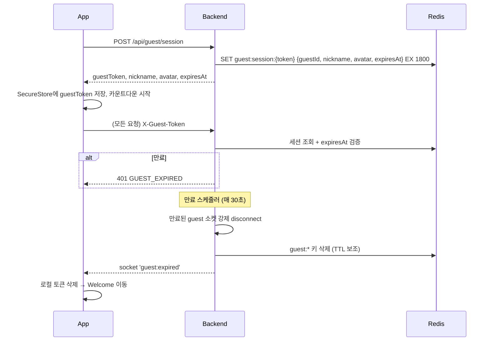

# Orbit System Design

- 문서 버전: 1.0 (2026-10-31)
- 관련: [prd.md](./prd.md) · [database.md](./database.md) · [api_spec.md](./api_spec.md)

---

## 1. 기술 스택

| 영역 | 기술 | 역할 |
|---|---|---|
| Mobile/Web Client | React Native + Expo (+ react-native-web) | iOS / Android / Web 앱, UI, 상태 관리 |
| Backend | Express.js | REST API |
| Realtime | Socket.io | 메시지, 입장·퇴장, 온라인 상태 |
| DB | PostgreSQL 16 | 회원, 취향, 라운지, 채팅방, 회원 메시지, 질문 |
| Cache/임시 저장 | Redis | **Guest 세션·Guest 데이터(TTL)**, 온라인 상태, Rate Limit, (확장 시) Socket.io adapter |
| Auth | JWT + bcrypt | 회원 인증 토큰, 비밀번호 해싱 |
| Client 토큰 저장 | Expo SecureStore (앱) / HttpOnly 쿠키 또는 localStorage (웹) | 회원 JWT, Guest 세션 토큰 |

> 기획 초안에서는 "Redis는 나중에 도입해도 됨"이었지만, **Guest 데이터를 PostgreSQL에 남기지 않는다는 정책** 때문에 MVP부터 Redis를 사용한다.

## 2. 아키텍처



## 3. 인증 구조

세 가지 미들웨어로 회원과 Guest가 같은 API를 함께 사용한다.

| 미들웨어 | 허용 대상 | 검증 방법 | `req.actor` |
|---|---|---|---|
| `memberAuth` | 회원만 | `Authorization: Bearer <JWT>` 검증 | `{ type: 'member', id }` |
| `guestAuth` | Guest만 | `X-Guest-Token` → Redis `guest:session:{token}` 조회 + `expires_at` 확인 | `{ type: 'guest', id, expiresAt }` |
| `optionalAuth` | 회원·Guest 모두 | 둘 중 하나라도 유효하면 통과 | 위 둘 중 하나 |

- 공통 식별자: 코드 전반에서 **actor** = `{type, id}` 로 통일 (`member:uuid` / `guest:uuid`)
- Socket.io 연결 시 `auth: { token }` 또는 `auth: { guestToken }` 으로 동일하게 검증

## 4. Guest 세션 설계



### 4-1. Redis 키 설계 (Guest)
| 키 | 타입 | 내용 | TTL |
|---|---|---|---|
| `guest:session:{token}` | Hash | guestId, nickname, avatarId, createdAt, expiresAt | expiresAt까지 |
| `guest:id:{guestId}` | String | token (역조회) | 동일 |
| `guest:tastes:{guestId}` | Hash | tagId → weight | 동일 |
| `guest:rooms:{guestId}` | Set | 참여 중인 roomId | 동일 |
| `room:{roomId}:guestmsgs` | List | Guest가 포함된 1:1 방 / 라운지의 Guest 메시지 JSON | 해당 guest 만료 시 정리 |
| `guest:answers:{guestId}` | Hash | questionId → 답변 | 동일 |
| `guest:msgcount:{guestId}` | String | 보낸 메시지 수 (가입 유도 트리거) | 동일 |

### 4-2. 원칙
- **절대 시간제**: `expiresAt = createdAt + 30분`, 갱신하지 않는다.
- **TTL에만 의존하지 않는다**: 모든 HTTP 요청·소켓 이벤트에서 `expiresAt`을 서버가 직접 확인.
- **로그 금지**: Guest 메시지 본문은 console/에러 로그/분석 이벤트에 남기지 않는다. 로거에서 `content` 필드 마스킹.
- 신고 시에만 해당 메시지 스냅샷을 `reports`에 저장 (예외).

### 4-3. 메시지 저장 규칙
| 상황 | 저장 위치 |
|---|---|
| Member ↔ Member 1:1 | PostgreSQL `messages` |
| Member/Guest ↔ Guest 1:1 | Redis `room:{id}:guestmsgs` (방 전체를 임시방으로 취급) |
| 라운지에서 Member가 보낸 메시지 | PostgreSQL `messages` |
| 라운지에서 Guest가 보낸 메시지 | Redis (만료 시 삭제) |

> 라운지 히스토리 조회 시 PostgreSQL + Redis를 시간순 병합해서 반환.

### 4-4. Guest → 회원 전환 (#14)
1. Guest가 `POST /api/auth/register` 요청 시 `X-Guest-Token`을 함께 보냄
2. 서버 트랜잭션:
   - users 생성
   - `guest:tastes` → `user_tastes` INSERT
   - `guest:rooms`의 방 → `chat_members`의 actor를 member로 교체, 방의 `is_temporary=false`
   - `room:{id}:guestmsgs` 중 해당 Guest가 속한 방의 메시지 → `messages` INSERT (sender를 새 userId로)
   - `guest:answers` → `question_answers` INSERT
3. Redis guest 키 삭제, 소켓 재인증(`auth:upgrade` 이벤트)
4. 상대방 화면에서는 닉네임·캐릭터가 그대로 유지됨 (가입 시 Guest 닉네임 유지 옵션 기본 ON)

> 상대방도 Guest인 1:1 방은, 가입한 쪽 기록만 남고 상대 Guest 만료 시 상대 메시지는 "사라진 궤도의 메시지"로 표시 여부를 #14에서 결정.

## 5. 실시간(Socket.io) 이벤트

| 방향 | 이벤트 | payload | 설명 |
|---|---|---|---|
| C→S | `room:join` | `{roomId}` | 1:1 방 또는 라운지 입장 |
| C→S | `room:leave` | `{roomId}` | 퇴장 |
| C→S | `message:send` | `{roomId, content, clientId}` | 메시지 전송 (필터·Rate Limit 적용) |
| C→S | `typing` | `{roomId}` | 입력 중 |
| S→C | `message:new` | `{id, roomId, sender:{displayName, avatarId}, content, createdAt}` | 새 메시지 |
| S→C | `room:presence` | `{roomId, count}` | 라운지 참여 인원 |
| S→C | `match:request` / `match:accepted` | `{matchId, ...}` | 매칭 |
| S→C | `guest:warning` | `{remainingSec: 300}` | 만료 5분 전 (가입 유도) |
| S→C | `guest:expired` | `{}` | 만료, 서버가 연결 종료 |
| S→C | `signup:nudge` | `{reason}` | 메시지 수 기준 가입 유도 |
| S→C | `error` | `{code, message}` | `RATE_LIMITED`, `BLOCKED_WORD` 등 |

## 6. 매칭 알고리즘 (#13)

```
vec(user) = { tagId: weight(1~3) * categoryWeight }
similarity(A, B) = Σ(A_i * B_i) / (‖A‖ * ‖B‖)
```
1. 후보군: 현재 온라인 actor (Redis `online:actors`) 중 본인 제외
2. 제외: 차단 관계(양방향), 이미 활성 1:1 방이 있는 상대, 최근 거절한 상대(24h)
3. 유사도 상위 N명(기본 10) + 공통 태그 상위 3개 반환
4. 후보가 부족하면 오프라인 Member까지 확장 (요청은 대기 상태로)

## 7. 디렉토리 구조 (목표, #2에서 적용)

```
src/
├── frontend/
│   ├── App.js
│   ├── navigation/          # RootNavigator, MainTabs
│   ├── screens/
│   │   ├── Welcome/
│   │   ├── Auth/            # Login, Register
│   │   ├── GuestEntry/
│   │   ├── TasteSelect/
│   │   ├── Home/
│   │   ├── Lounge/          # LoungeList, LoungeChat
│   │   ├── Chat/            # ChatList, ChatRoom, Matching
│   │   ├── TodayQuestion/
│   │   └── MyOrbit/
│   ├── components/
│   │   ├── OrbitVisualization/
│   │   ├── Avatar/
│   │   ├── TasteTags/
│   │   ├── GuestTimer/
│   │   └── SignupNudgeModal/
│   ├── context/             # AuthContext (actor, token, expiresAt)
│   ├── theme/               # colors, typography, spacing
│   └── services/            # api.js, socket.js, storage.js
│
├── backend/
│   ├── server.js
│   ├── db.js
│   ├── redis.js
│   ├── routes/              # auth, guest, users, tastes, matching, lounges, chat, questions, reports
│   ├── services/            # guestSession, matching, chat, orbit, migration(guest→member)
│   ├── socket/              # index.js, handlers/
│   ├── middleware/          # memberAuth, guestAuth, optionalAuth, rateLimit, profanityFilter
│   ├── jobs/                # guestExpiry
│   ├── migrations/
│   └── seeds/               # 취향 태그, 라운지, 오늘의 질문
│
docs/  (prd, system_design, database, api_spec, tasks, progress, deploy)
```

## 8. 환경 변수 (`src/backend/.env.example`)
| 변수 | 예시 | 설명 |
|---|---|---|
| `PORT` | 3000 | |
| `DATABASE_URL` | postgres://localhost:5432/orbit | |
| `REDIS_URL` | redis://localhost:6379 | |
| `JWT_SECRET` | (랜덤 문자열) | |
| `JWT_EXPIRES_IN` | 7d | |
| `GUEST_SESSION_MINUTES` | 30 | Guest 이용 시간 |
| `GUEST_WARNING_MINUTES` | 5 | 만료 경고 시점 |
| `GUEST_NUDGE_MESSAGE_COUNT` | 20 | 가입 유도 메시지 수 |
| `CORS_ORIGIN` | http://localhost:8081 | |
