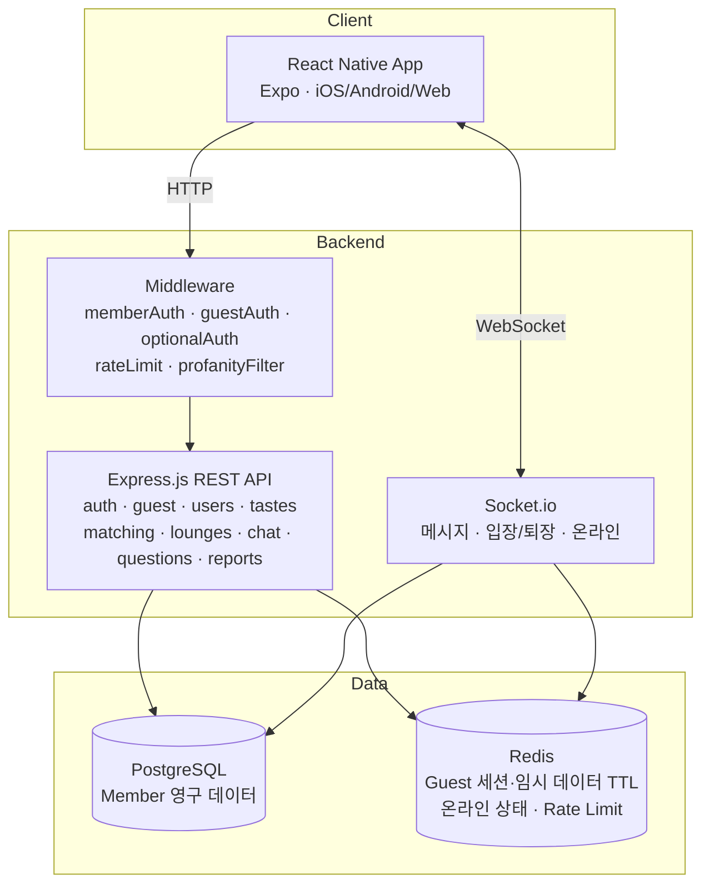
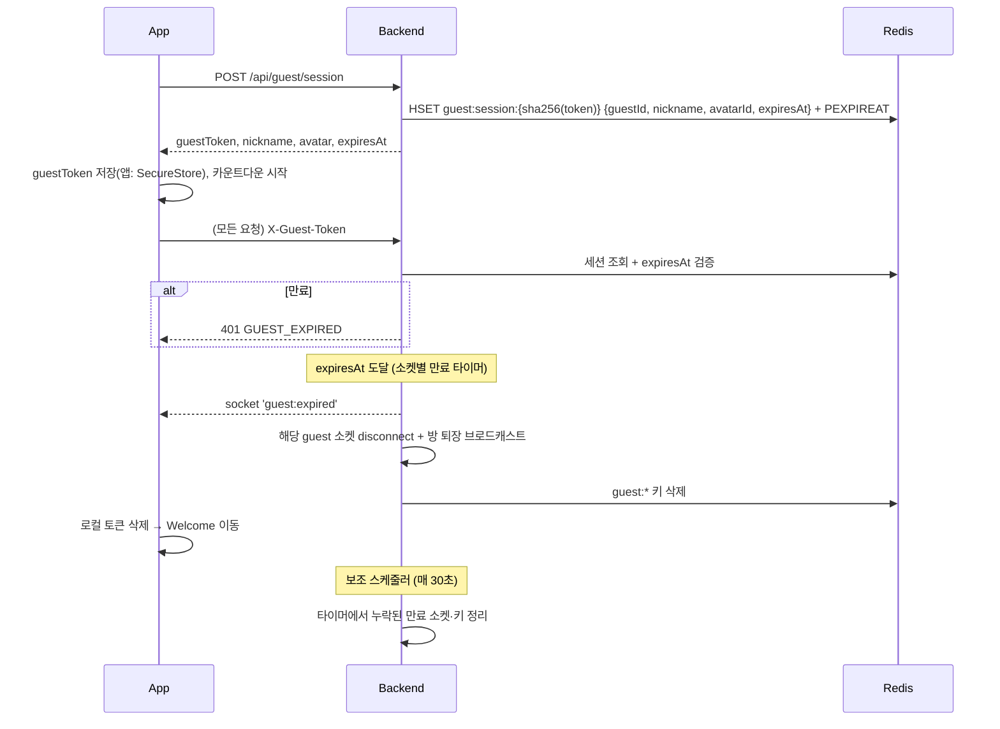

# Orbit System Design

- 문서 버전: 1.0 (2026-10-31)
- 관련: [prd.md](./prd.md) · [database.md](./database.md) · [api_spec.md](./api_spec.md)

---

## 1. 기술 스택

| 영역 | 기술 | 역할 |
|---|---|---|
| Mobile/Web Client | React Native + Expo (+ react-native-web) | iOS / Android / Web 앱, UI, 상태 관리 |
| Backend | Express.js | REST API |
| Realtime | Socket.io | 메시지, 입장·퇴장, 온라인 상태 |
| DB | PostgreSQL 16 | 회원, 취향, 라운지, 채팅방, 회원 메시지, 질문 |
| Cache/임시 저장 | Redis | **Guest 세션·Guest 데이터(TTL)**, 온라인 상태, Rate Limit, (확장 시) Socket.io adapter |
| Auth | JWT + bcrypt | 회원 인증 토큰, 비밀번호 해싱 |
| Client 토큰 저장 | **iOS·Android:** Expo SecureStore / **Web:** 미결정(HttpOnly 쿠키 vs localStorage, #5에서 결정) | 회원 JWT, Guest 세션 토큰 |

> 기획 초안에서는 "Redis는 나중에 도입해도 됨"이었지만, **Guest 데이터를 PostgreSQL에 남기지 않는다는 정책** 때문에 MVP부터 Redis를 사용한다.

## 2. 아키텍처



## 3. 인증 구조

세 가지 미들웨어로 회원과 Guest가 같은 API를 함께 사용한다.

| 미들웨어 | 허용 대상 | 검증 방법 | `req.actor` |
|---|---|---|---|
| `memberAuth` | 회원만 | `Authorization: Bearer <JWT>` 검증 | `{ type: 'member', id }` |
| `guestAuth` | Guest만 | `X-Guest-Token` → Redis `guest:session:{sha256(token)}` 조회 + `expiresAt` 직접 비교 | `{ type: 'guest', id, expiresAt }` (+ `req.guest`) |
| `optionalAuth` | 회원·Guest 모두 | Bearer가 있으면 회원 검증, 없고 `X-Guest-Token`이 있으면 Guest 검증 | 위 둘 중 하나 (Guest는 `req.userId` 없음) |

- 공통 식별자: 코드 전반에서 **actor** = `{type, id}` 로 통일 (`member:uuid` / `guest:uuid`)
- Socket.io 연결 시 `auth: { token }` 또는 `auth: { guestToken }` 으로 동일하게 검증

## 4. Guest 세션 설계



### 4-1. Redis 키 설계 (Guest)
| 키 | 타입 | 내용 | TTL |
|---|---|---|---|
| `guest:session:{sha256(token)}` | Hash | guestId, nickname, avatarId, avatarEmoji, expiresAt (토큰 원본은 저장하지 않음) | expiresAt까지 (#5) |
| `guest:id:{guestId}` | String | 세션 키 (역조회, 강제 종료용) | 동일 (#12에서 추가) |
| `guest:tastes:{guestId}` | Hash | tagId → weight (저장 시 DEL+HSET+PEXPIREAT를 MULTI로, `DELETE /guest/session` 시 함께 삭제) | 동일 (#7) |
| `guest:rooms:{guestId}` | Set | 참여 중인 1:1 roomId | 동일 (#13) |
| `guest:lounges:{guestId}` | Set | 참여한 loungeId | 동일 (#11) |
| `lounge:{loungeId}:guests` | Sorted Set | guestId, score = 세션 expiresAt. 인원 계산 시 score > now만 셈, 참여 때 만료분 정리 | 마지막 참여 후 30분 (#11) |
| `room:{roomId}:guestmsgs` | List | Guest 메시지 JSON(작성자 `guestId`·`expiresAt` 포함, 최근 500개). 읽을 때 만료된 작성자 메시지 제외 (#10) | 마지막 Guest 메시지 후 30분. 만료 즉시 삭제는 #12 |
| `guest:answers:{guestId}` | Hash | questionId → 답변 | 동일 |
| `guest:msgcount:{guestId}` | String | 보낸 메시지 수 (가입 유도 트리거) | 동일 |

### 4-2. 원칙
- **절대 시간제**: `expiresAt = createdAt + 30분`, 갱신하지 않는다.
- **TTL에만 의존하지 않는다**: 모든 HTTP 요청·소켓 이벤트에서 `expiresAt`을 서버가 직접 확인.
- **만료 시점에 즉시 종료한다**: Guest 소켓이 연결되면 `expiresAt - now` 후에 실행되는 만료 타이머를 등록한다. 타이머는 `guest:expired` 이벤트를 **먼저 보낸 뒤** 연결을 끊는다(끊은 뒤에는 이벤트를 받을 수 없음).
- **30초 스케줄러는 보조 수단**이다. 서버 재시작 등으로 타이머가 누락된 소켓과 Redis 키만 정리한다.
- **수신자도 확인한다**: 방에 메시지를 브로드캐스트할 때 수신자 중 만료된 Guest 소켓은 제외(그리고 즉시 종료)한다.
- **로그 금지**: Guest 메시지 본문은 console/에러 로그/분석 이벤트에 남기지 않는다. 로거에서 `content` 필드 마스킹.
- 신고 시에만 해당 메시지 스냅샷을 `reports`에 저장 (예외).

### 4-3. 메시지 저장 규칙
| 상황 | 저장 위치 |
|---|---|
| Member ↔ Member 1:1 | PostgreSQL `messages` (방: `chat_rooms` + `chat_members`) |
| Member/Guest ↔ Guest 1:1 | Redis `room:{id}:guestmsgs` — **방 자체도 Redis에만** 존재 (PG `chat_rooms` 행 없음) |
| 라운지에서 Member가 보낸 메시지 | PostgreSQL `messages` |
| 라운지에서 Guest가 보낸 메시지 | Redis (만료 시 삭제) |

> 라운지 히스토리 조회 시 PostgreSQL + Redis를 시간순 병합해서 반환.

### 4-4. Guest → 회원 전환 (#14)
1. Guest가 `POST /api/auth/register` 요청 시 `X-Guest-Token`을 함께 보냄
2. 서버 트랜잭션:
   - users 생성
   - `guest:tastes` → `user_tastes` INSERT
   - `guest:rooms`의 방(Redis 임시방) → 상대가 **회원**이면 `chat_rooms`(direct) + `chat_members` 2행을 PG에 새로 생성 / 상대가 **Guest**면 방은 Redis에 그대로 두고 본인만 회원으로 표시 (#14에서 확정)
   - `guest:lounges`의 라운지 → `lounge_members` INSERT, `lounge:{id}:guests`에서 제거
   - `room:{id}:guestmsgs`에서 **가입한 Guest 본인이 보낸 메시지만** → `messages` INSERT (sender = 새 userId)
   - 같은 방의 **Member 메시지**는 원래 작성자(sender_id)를 그대로 유지한다 (이미 PG에 있으면 그대로, Redis에 있으면 원 작성자로 INSERT)
   - **다른 Guest(가입하지 않은 상대)의 메시지는 PostgreSQL로 이전하지 않는다** — Guest 메시지 보관 정책 유지. 해당 Guest 만료 시 Redis에서 삭제
   - `guest:answers` → `question_answers` INSERT
3. Redis guest 키 삭제, 소켓 재인증(`auth:upgrade` 이벤트)
4. 상대방 화면에서는 닉네임·캐릭터가 그대로 유지됨 (가입 시 Guest 닉네임 유지 옵션 기본 ON)

> 상대방도 Guest인 1:1 방은, 가입한 쪽 기록만 남고 상대 Guest 만료 시 상대 메시지는 "사라진 궤도의 메시지"로 표시 여부를 #14에서 결정.

## 5. 실시간(Socket.io) 이벤트

- **연결 인증**: `auth.token`(회원 JWT) 또는 `auth.guestToken`(Guest). 거절 시 `connect_error`의 `data.code` = `UNAUTHORIZED` / `GUEST_EXPIRED` / `UNAVAILABLE`
- **Guest는 모든 이벤트 처리 전** 세션을 다시 확인하고, 만료(시간·직접 종료)면 `guest:expired`를 보낸 뒤 연결을 끊는다 (#10). 소켓별 만료 타이머·5분 전 알림은 #12
- **결과·오류는 ack 콜백** `{ ok: true, ... }` / `{ ok: false, code, message }` (`ROOM_NOT_FOUND`, `ROOM_CLOSED`, `INVALID_MESSAGE`, `UNAVAILABLE`, `SERVER_ERROR`)

| 방향 | 이벤트 | payload | 설명 |
|---|---|---|---|
| C→S | `room:join` | `{roomId}` → ack | 1:1(참여 회원만) 또는 라운지(회원·Guest) 입장 (#10) |
| C→S | `room:leave` | `{roomId}` | 소켓만 방에서 나감 (1:1 방 나가기는 REST `POST /chat/rooms/:id/leave`) |
| C→S | `message:send` | `{roomId, content}` → ack `{ok, id}` | 1~1000자, 비속어 가림, 회원 PG / Guest Redis 저장 (#10). Rate Limit #16 |
| C→S | `typing` | `{roomId}` | 입력 중 (같은 방의 다른 소켓에게 `typing {roomId}`) |
| S→C | `message:new` | `{id, room_id, content, created_at, is_mine, is_guest, sender_nickname, sender_avatar_emoji}` | 새 메시지. `is_mine`은 받는 소켓마다 계산, 만료된 Guest 수신자는 받지 않고 종료 |
| S→C | `typing` | `{roomId}` | 상대 입력 중 |
| S→C | `guest:expired` | `{}` | 만료, 서버가 연결 종료 (#10 이벤트 시점, #12 타이머) |
| S→C | `room:presence` | `{roomId, count}` | 라운지 채팅방에 **지금 접속 중인 사람 수**(같은 사람 여러 기기는 1명). 입장·퇴장·연결 끊김 때 방 전체에 전송 (#11) |
| S→C | `match:request` / `match:accepted` | `{matchId, ...}` | 매칭 (#13) |
| S→C | `guest:warning` | `{remainingSec: 300}` | 만료 5분 전 (#12) |
| S→C | `signup:nudge` | `{reason}` | 메시지 수 기준 가입 유도 (#14) |

## 6. 매칭 알고리즘 (#13)

```
vec(user) = { tagId: weight(1~3) * categoryWeight }
similarity(A, B) = Σ(A_i * B_i) / (‖A‖ * ‖B‖)
```
1. 후보군: 현재 온라인 actor (Redis `online:actors`) 중 본인 제외
2. 제외: 차단 관계(양방향), 이미 활성 1:1 방이 있는 상대, 최근 거절한 상대(24h)
3. 유사도 상위 N명(기본 10) + 공통 태그 상위 3개 반환
4. 후보가 부족하면 빈 목록 + "지금은 비슷한 사람이 없어요, 라운지를 둘러보세요" 안내 (PRD §3-2: **현재 접속 중인 Member·Guest만** 대상)
   - 오프라인 Member 확장은 V2 검토 항목

## 7. 디렉토리 구조 (목표, #2에서 적용)

```
src/
├── frontend/
│   ├── App.js
│   ├── navigation/          # RootNavigator, MainTabs
│   ├── screens/
│   │   ├── Welcome/
│   │   ├── Auth/            # Login, Register
│   │   ├── GuestEntry/
│   │   ├── TasteSelect/
│   │   ├── Home/
│   │   ├── Lounge/          # LoungeList, LoungeChat
│   │   ├── Chat/            # ChatList, ChatRoom, Matching
│   │   ├── TodayQuestion/
│   │   └── MyOrbit/
│   ├── components/
│   │   ├── OrbitVisualization/
│   │   ├── Avatar/
│   │   ├── TasteTags/
│   │   ├── GuestTimer/
│   │   └── SignupNudgeModal/
│   ├── context/             # AuthContext (actor, token, expiresAt)
│   ├── theme/               # colors, typography, spacing
│   ├── services/            # api.js, socket.js, storage.js
│   └── _legacy/             # MVP에서 쓰지 않는 이전 코드 보관 (새 코드에서 import 금지)
│                            #   예외: MyOrbit의 RadarChart 임시 사용 (#17에서 제거)
│
├── backend/
│   ├── server.js
│   ├── db.js
│   ├── redis.js
│   ├── routes/              # auth, guest, users, tastes, matching, lounges, chat, questions, reports
│   ├── services/            # matching (이후 추가: guestSession, chat, orbit, migration)
│   ├── socket/              # index.js, handlers/
│   ├── middleware/          # memberAuth, guestAuth, optionalAuth, rateLimit, profanityFilter
│   ├── jobs/                # guestExpiry
│   ├── migrations/
│   └── seeds/               # 취향 태그, 라운지, 오늘의 질문
│
docs/  (prd, system_design, database, api_spec, tasks, progress, deploy)
```

## 8. 환경 변수 (`src/backend/.env.example`)
| 변수 | 예시 | 설명 |
|---|---|---|
| `PORT` | 3000 | |
| `DATABASE_URL` | postgres://localhost:5432/orbit | |
| `REDIS_URL` | redis://localhost:6379 | |
| `JWT_SECRET` | (랜덤 문자열) | |
| `JWT_EXPIRES_IN` | 7d | |
| `GUEST_SESSION_MINUTES` | 30 | Guest 이용 시간 |
| `GUEST_WARNING_MINUTES` | 5 | 만료 경고 시점 |
| `GUEST_NUDGE_MESSAGE_COUNT` | 20 | 가입 유도 메시지 수 |
| `CORS_ORIGIN` | http://localhost:8081 | |
