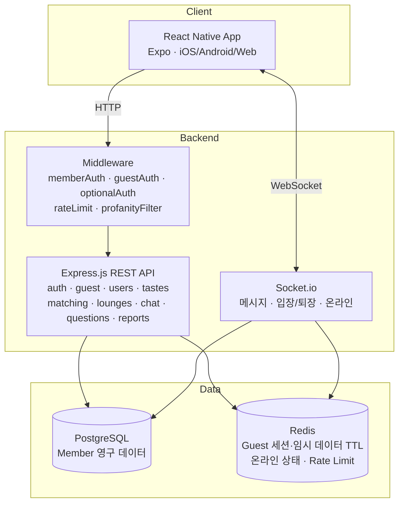
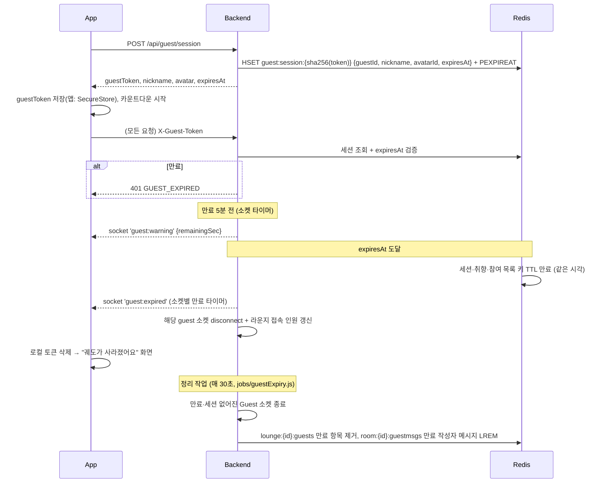

# Orbit System Design

- 문서 버전: 1.0 (2026-10-31)
- 관련: [prd.md](./prd.md) · [database.md](./database.md) · [api_spec.md](./api_spec.md)

---

## 1. 기술 스택

| 영역 | 기술 | 역할 |
|---|---|---|
| Mobile/Web Client | React Native + Expo (+ react-native-web) | iOS / Android / Web 앱, UI, 상태 관리 |
| Backend | Express.js | REST API |
| Realtime | Socket.io | 메시지, 입장·퇴장, 온라인 상태 |
| DB | PostgreSQL 16 | 회원, 취향, 라운지, 채팅방, 회원 메시지, 질문 |
| Cache/임시 저장 | Redis | **Guest 세션·Guest 데이터(TTL)**, 온라인 상태, Rate Limit, (확장 시) Socket.io adapter |
| Auth | JWT + bcrypt | 회원 인증 토큰, 비밀번호 해싱 |
| Client 토큰 저장 | **iOS·Android:** Expo SecureStore / **Web:** 미결정(HttpOnly 쿠키 vs localStorage, #5에서 결정) | 회원 JWT, Guest 세션 토큰 |

> 기획 초안에서는 "Redis는 나중에 도입해도 됨"이었지만, **Guest 데이터를 PostgreSQL에 남기지 않는다는 정책** 때문에 MVP부터 Redis를 사용한다.

## 2. 아키텍처



## 3. 인증 구조

세 가지 미들웨어로 회원과 Guest가 같은 API를 함께 사용한다.

| 미들웨어 | 허용 대상 | 검증 방법 | `req.actor` |
|---|---|---|---|
| `memberAuth` | 회원만 | `Authorization: Bearer <JWT>` 검증 | `{ type: 'member', id }` |
| `guestAuth` | Guest만 | `X-Guest-Token` → Redis `guest:session:{sha256(token)}` 조회 + `expiresAt` 직접 비교 | `{ type: 'guest', id, expiresAt }` (+ `req.guest`) |
| `optionalAuth` | 회원·Guest 모두 | Bearer가 있으면 회원 검증, 없고 `X-Guest-Token`이 있으면 Guest 검증 | 위 둘 중 하나 (Guest는 `req.userId` 없음) |

- 공통 식별자: 코드 전반에서 **actor** = `{type, id}` 로 통일 (`member:uuid` / `guest:uuid`)
- Socket.io 연결 시 `auth: { token }` 또는 `auth: { guestToken }` 으로 동일하게 검증

## 4. Guest 세션 설계



### 4-1. Redis 키 설계 (Guest)
| 키 | 타입 | 내용 | TTL |
|---|---|---|---|
| `guest:session:{sha256(token)}` | Hash | guestId, nickname, avatarId, avatarEmoji, expiresAt (토큰 원본은 저장하지 않음) | expiresAt까지 (#5) |
| `guest:id:{guestId}` | String | 세션 키 (역조회, 강제 종료용) | 동일 (#12에서 추가) |
| `guest:tastes:{guestId}` | Hash | tagId → weight (저장 시 DEL+HSET+PEXPIREAT를 MULTI로, `DELETE /guest/session` 시 함께 삭제) | 동일 (#7) |
| `guest:profile:{guestId}` | Hash | nickname, avatarId, avatarEmoji, expiresAt — guestId로 표시 정보를 찾기 위한 복사본 (매칭 후보·1:1 방) | 동일 (#13) |
| `guest:lounges:{guestId}` | Set | 참여한 loungeId | 동일 (#11) |
| `lounge:{loungeId}:guests` | Sorted Set | guestId, score = 세션 expiresAt. 인원 계산 시 score > now만 셈, 참여 때 만료분 정리 | 마지막 참여 후 30분 (#11) |
| `room:{roomId}:guestmsgs` | List | Guest 메시지 JSON(작성자 `guestId`·`expiresAt` 포함, 최근 500개). 읽을 때 만료된 작성자 메시지 제외 (#10) | 마지막 Guest 메시지 후 30분. 만료 작성자 메시지는 30초 정리 작업이 제거 (#12) |
| `online:actors` | Hash | actorKey(`member:{id}`·`guest:{id}`) → 연결된 소켓 수. 연결 +1, 끊김 -1(0이면 삭제, Lua로 한 번에), 서버 시작 시 비움 | 없음 (#13) |
| `room:{roomId}` | Hash | Guest가 낀 1:1 방: createdAt, expiresAt, members(JSON: actorKey·방 단위 닉네임·캐릭터·Guest 여부), `left:{actorKey}` | 참여 Guest 중 가장 이른 만료 시각 (#13) |
| `room:{roomId}:msgs` | List | 위 방의 **모든** 메시지 JSON(회원 메시지 포함, 최근 500개) | 방과 같음 (#13) |
| `actor:rooms:{actorKey}` | Set | 참여 중인 Redis 1:1 roomId. 회원 목록은 읽을 때 사라진 방 정리 | Guest는 본인 만료 시각, 회원은 없음 (#13) |
| `match:ref:{ref}` | String | 후보 참조 JSON {owner, target, score, common}. 발급받은 사람만 사용, 요청하면 삭제 | 10분 (#13) |
| `match:{matchId}` | Hash | Guest가 낀 매칭 요청: requester, target, status, similarity, commonTagIds, createdAt, roomId | 참여 Guest 중 가장 이른 만료 시각 (#13) |
| `match:pair:{a}\|{b}` | String | 두 사람 사이 요청 하나(SET NX) — 대기·거절 상태 동안 다시 요청 불가 | 동일 (#13) |
| `actor:matches:{actorKey}` | Set | 보낸·받은 Redis 요청 matchId (회원 목록은 읽을 때 정리) | Guest는 본인 만료 시각 (#13) |
| `guest:answers:{guestId}` | Hash | questionId → 답변 | 동일 |
| `guest:msgcount:{guestId}` | String | 보낸 메시지 수 — 20개째 INCR 결과일 때만 `signup:nudge` 1회 | 동일 (#14) |
| `guest:upgrade:{guestId}` | String | 가입 전환 선점(SET NX) — 같은 토큰으로 동시에 가입해도 한 요청만 이전 | 60초 또는 전환 완료 시 삭제 (#14) |

### 4-2. 원칙
- **절대 시간제**: `expiresAt = createdAt + 30분`, 갱신하지 않는다.
- **TTL에만 의존하지 않는다**: 모든 HTTP 요청·소켓 이벤트에서 `expiresAt`을 서버가 직접 확인.
- **만료 시점에 즉시 종료한다**: Guest 소켓이 연결되면 `expiresAt - now` 후에 실행되는 만료 타이머를 등록한다. 타이머는 `guest:expired` 이벤트를 **먼저 보낸 뒤** 연결을 끊는다(끊은 뒤에는 이벤트를 받을 수 없음).
- **30초 정리 작업은 보조 수단**이다 (`jobs/guestExpiry.js`, 서버 프로세스 안 `setInterval`, 주기 `GUEST_CLEANUP_INTERVAL_MS`). 만료됐거나 세션이 없어진(다른 기기에서 종료) Guest 소켓 종료, 라운지 Sorted Set의 만료 Guest 제거, 라운지 Guest 메시지 리스트에서 만료 작성자 메시지 제거(LREM — 동시에 들어오는 새 메시지를 잃지 않게 리스트를 다시 쓰지 않음). 세션·취향·참여 목록 키는 세션과 같은 시각의 TTL로 사라진다 (#12)
- **만료 5분 전 `guest:warning`**: 소켓 타이머로 1회, 연결 시 이미 5분 이하면 바로 (#12). 앱은 가입 유도 모달 (#14)
- **수신자도 확인한다**: 방에 메시지를 브로드캐스트할 때 수신자 중 만료된 Guest 소켓은 제외(그리고 즉시 종료)한다.
- **로그 금지**: Guest 메시지 본문은 console/에러 로그/분석 이벤트에 남기지 않는다. 로거에서 `content` 필드 마스킹.
- 신고 시에만 해당 메시지 스냅샷을 `reports`에 저장 (예외).

### 4-3. 메시지 저장 규칙
| 상황 | 저장 위치 |
|---|---|
| Member ↔ Member 1:1 | PostgreSQL `messages` (방: `chat_rooms` + `chat_members`) |
| Member/Guest ↔ Guest 1:1 | Redis `room:{id}:msgs` — **방 자체도 Redis에만**(`room:{id}`), 회원 메시지도 Redis. 참여 Guest가 만료되면 방·메시지가 함께 사라짐 (#13) |
| 라운지에서 Member가 보낸 메시지 | PostgreSQL `messages` |
| 라운지에서 Guest가 보낸 메시지 | Redis (만료 시 삭제) |

> 라운지 히스토리 조회 시 PostgreSQL + Redis를 시간순 병합해서 반환.

### 4-4. Guest → 회원 전환 (#14)
**가입 유도:** 채팅방 "대화 저장하기", 만료 5분 전(`guest:warning`), 보낸 메시지 20개(`signup:nudge`) → 가입 유도 모달. "나중에"를 누르면 남은 시간 동안 계속 이용. My Orbit(Guest)에도 "가입하고 이어가기"
**가입 화면:** 같은 RegisterScreen을 Guest 닉네임(12자 넘으면 잘라서)·캐릭터로 미리 채움(수정 가능), 요청에 `X-Guest-Token`이 함께 감

1. `POST /api/auth/register` + `X-Guest-Token` → 세션이 유효하고 아직 옮기지 않은 Guest(`users.upgraded_from_guest`에 없음)면 `guest:upgrade:{guestId}` 선점(SET NX, 실패 시 409 `UPGRADE_IN_PROGRESS`). 만료·위조 토큰·이미 옮긴 Guest면 이전 없이 일반 가입(`migrated: false`)
2. Redis에서 이전할 데이터를 먼저 읽는다 (트랜잭션 안에서 Redis를 기다리지 않게)
3. **PG 한 트랜잭션** (`services/guestUpgrade.js`):
   - users 생성 (`upgraded_from_guest` = guestId, UNIQUE — 선점이 만료되거나 커밋 후 정리가 실패해도 같은 Guest는 한 번만 옮겨짐)
   - `guest:tastes` → `user_tastes`
   - `guest:lounges` → `lounge_members` (이미 정원에 Guest로 포함된 자리라 정원 확인 없음)
   - 라운지 `room:{id}:guestmsgs`의 **본인 메시지만** → `messages` (같은 id·시각, sender = 새 userId)
   - **회원과의 1:1 Redis 방** → 같은 roomId로 `chat_rooms` + `chat_members` 2행(방 단위 표시 이름·캐릭터 = 방에서 쓰던 값) + 방의 모든 메시지(회원 메시지는 원 작성자, 본인 메시지는 새 userId, 순서 유지)
   - 하나라도 실패하면 회원 생성까지 되돌리고 선점 해제 → Guest는 그대로, 다시 시도 가능
4. **커밋 후 Redis 정리** (실패해도 가입은 성공, 남은 키는 세션 만료 시각에 TTL로 사라짐)
   - 세션 키부터 삭제 → 같은 토큰으로 다시 이전되지 않음
   - 옮긴 라운지 메시지 LREM, 옮긴 1:1 방 삭제
   - **Guest끼리 방은 Redis에 그대로**: Lua 한 번에 참여자·메시지 작성자 키를 `member:{userId}`로, `is_guest=false`로 바꾸고 방 만료를 **남은 Guest의 만료 시각**으로, 두 사람의 방 목록 키도 같은 Lua에서 바꾼다. 두 Guest가 동시에 가입해 Guest가 남지 않으면 그 방은 PG로 옮긴다
   - 취향·표시 정보·라운지 참여·대기 중인 매칭 요청(옮기지 않음)·메시지 수 정리
   - 그 Guest의 소켓은 이벤트 없이 끊는다 (`guest:expired`를 보내면 앱이 만료 화면으로 감)
5. 앱: 회원 토큰 저장(Guest 토큰 삭제) → `/auth/me` → 소켓을 회원 토큰으로 다시 연결(별도 `auth:upgrade` 이벤트 없음). 화면 구독은 소켓이 바뀌어도 유지되고, 채팅방에서 가입했으면 그 방으로 돌아간다
6. 상대 화면: 닉네임·캐릭터 그대로, Guest 배지만 빠짐
- 이전하지 않음: 다른 Guest의 메시지, 오늘의 질문 답변(#15)

## 5. 실시간(Socket.io) 이벤트

- **연결 인증**: `auth.token`(회원 JWT) 또는 `auth.guestToken`(Guest). 거절 시 `connect_error`의 `data.code` = `UNAUTHORIZED` / `GUEST_EXPIRED` / `UNAVAILABLE`
- **Guest는 모든 이벤트 처리 전** 세션을 다시 확인하고, 만료(시간·직접 종료)면 `guest:expired`를 보낸 뒤 연결을 끊는다 (#10). 이벤트가 없어도 **소켓별 만료 타이머**가 `expiresAt`에 같은 처리를 한다 (#11, PR #28). 5분 전 알림·30초 정리 작업은 #12
- **연결 시** actor 전용 방 `actor:{actorKey}`에 들어가고(매칭 이벤트 전달용), `online:actors`에 기록 (#13)
- **결과·오류는 ack 콜백** `{ ok: true, ... }` / `{ ok: false, code, message }` (`ROOM_NOT_FOUND`, `ROOM_CLOSED`, `INVALID_MESSAGE`, `UNAVAILABLE`, `SERVER_ERROR`)

| 방향 | 이벤트 | payload | 설명 |
|---|---|---|---|
| C→S | `room:join` | `{roomId}` → ack | 1:1(참여 회원만) 또는 라운지(회원·Guest) 입장 (#10) |
| C→S | `room:leave` | `{roomId}` | 소켓만 방에서 나감 (1:1 방 나가기는 REST `POST /chat/rooms/:id/leave`) |
| C→S | `message:send` | `{roomId, content}` → ack `{ok, id}` | 1~1000자, 비속어 가림, 회원 PG / Guest Redis 저장 (#10). Rate Limit #16 |
| C→S | `typing` | `{roomId}` | 입력 중 (같은 방의 다른 소켓에게 `typing {roomId}`) |
| S→C | `message:new` | `{id, room_id, content, created_at, is_mine, is_guest, sender_nickname, sender_avatar_emoji}` | 새 메시지. `is_mine`은 받는 소켓마다 계산, 만료된 Guest 수신자는 받지 않고 종료 |
| S→C | `typing` | `{roomId}` | 상대 입력 중 |
| S→C | `guest:expired` | `{}` | 만료, 서버가 연결 종료 (#10 이벤트 시점, #11 소켓 타이머) |
| S→C | `room:presence` | `{roomId, count}` | 라운지 채팅방에 **지금 접속 중인 사람 수**(같은 사람 여러 기기는 1명). 입장·퇴장·연결 끊김 때 방 전체에 전송 (#11) |
| S→C | `match:request` | `{id, direction:'received', nickname, avatar_emoji, is_guest, similarity, common_tags, created_at}` | 대화 요청을 받음 (요청 대상의 모든 기기) (#13) |
| S→C | `match:accepted` | `{matchId, roomId, title}` | 수락됨 → 양쪽 모든 기기, `title`은 받는 사람 기준 상대 닉네임 (#13) |
| S→C | `match:rejected` | `{matchId}` | 요청자에게 (#13) |
| S→C | `guest:warning` | `{remainingSec}` | 만료 5분 전 1회, 연결 시 이미 5분 이하면 바로 (#12) |
| S→C | `signup:nudge` | `{reason: 'messages'}` | Guest가 보낸 메시지 20개째에 1회, 같은 Guest의 모든 기기 (#14) |

## 6. 매칭 알고리즘 (#13)

```
vec(actor) = { tagId: weight(1~3) }        # 카테고리 가중치는 MVP에선 모두 1
similarity(A, B) = Σ(A_i * B_i) / (‖A‖ * ‖B‖)
```
1. 후보군: `online:actors` 중 본인 제외, 취향 있는 회원(PG `user_tastes`)·Guest(Redis `guest:tastes`) (PRD §3-2: **지금 접속 중인 Member·Guest만**)
2. 제외: 차단 관계(양방향, 회원), 대화 중인 1:1 상대(PG·Redis 방 모두, 두 사람 다 남아 있는 방), 대기 중인 요청 상대(보낸·받은), 24시간 안에 거절한·거절당한 상대
3. 유사도 > 0, 상위 10명 + 공통 태그 3개(두 사람 중요도 곱이 큰 순)
4. 응답에는 실제 id 대신 `ref`(Redis `match:ref:{ref}`, 10분, 발급받은 사람만 사용). 요청 시 ref를 다시 확인하고 상대가 아직 접속 중인지 본다(`TARGET_OFFLINE`)
5. 요청 저장: 회원↔회원 PG `match_history`(대기 요청은 `uq_match_pending_pair`로 하나만, 24시간 응답 없으면 `expired`) / 한쪽이라도 Guest면 Redis `match:{id}` + `match:pair`(SET NX로 하나만)
6. 수락: 조건부 UPDATE(PG)·Lua 비교 후 변경(Redis)으로 **한 번만** → 회원끼리는 PG `chat_rooms`+`chat_members`, Guest가 끼면 Redis 방(`room:{id}`)
7. 후보가 없으면 빈 목록 + "지금은 취향이 비슷한 사람이 없어요. 라운지를 둘러보세요"
   - 오프라인 Member 확장은 V2 검토 항목

### 6-1. 대화 주제 (`GET /chat/rooms/:id/topics`)
- 두 사람의 공통 태그 상위 3개 → 카테고리별 템플릿 문장 (예: "Oasis 노래 중 최애 곡은 뭐예요?"), 같은 카테고리가 겹치면 다른 템플릿
- 공통 태그가 없거나 상대가 탈퇴한 방이면 일반 질문 2개

## 7. 디렉토리 구조 (목표, #2에서 적용)

```
src/
├── frontend/
│   ├── App.js
│   ├── navigation/          # RootNavigator, MainTabs
│   ├── screens/
│   │   ├── Welcome/
│   │   ├── Auth/            # Login, Register
│   │   ├── GuestEntry/
│   │   ├── TasteSelect/
│   │   ├── Home/
│   │   ├── Lounge/          # LoungeList, LoungeChat
│   │   ├── Chat/            # ChatList, ChatRoom, Matching
│   │   ├── TodayQuestion/
│   │   └── MyOrbit/
│   ├── components/
│   │   ├── OrbitVisualization/
│   │   ├── Avatar/
│   │   ├── TasteTags/
│   │   ├── GuestTimer/
│   │   └── SignupNudgeModal/
│   ├── context/             # AuthContext (actor, token, expiresAt)
│   ├── theme/               # colors, typography, spacing
│   ├── services/            # api.js, socket.js, storage.js
│   └── _legacy/             # MVP에서 쓰지 않는 이전 코드 보관 (새 코드에서 import 금지)
│                            #   ClubCreateScreen만 남음 (RadarChart·VennDiagram은 #17에서 삭제)
│
├── backend/
│   ├── server.js
│   ├── db.js
│   ├── redis.js
│   ├── routes/              # auth, guest, users, tastes, matching, lounges, chat, questions, reports
│   ├── services/            # matching, directRooms(Guest 1:1 방), online, actors, topics, guestSession, chat … (이후: migration)
│   ├── socket/              # index.js, handlers/
│   ├── middleware/          # memberAuth, guestAuth, optionalAuth, rateLimit, profanityFilter
│   ├── jobs/                # guestExpiry
│   ├── migrations/
│   └── seeds/               # 취향 태그, 라운지, 오늘의 질문
│
docs/  (prd, system_design, database, api_spec, tasks, progress, deploy)
```

## 8. 환경 변수 (`src/backend/.env.example`)
| 변수 | 예시 | 설명 |
|---|---|---|
| `PORT` | 3000 | |
| `DATABASE_URL` | postgres://localhost:5432/orbit | |
| `REDIS_URL` | redis://localhost:6379 | |
| `JWT_SECRET` | (랜덤 문자열) | |
| `JWT_EXPIRES_IN` | 7d | |
| `GUEST_SESSION_MINUTES` | 30 | Guest 이용 시간 |
| `GUEST_WARNING_MINUTES` | 5 | 만료 경고 시점 |
| `GUEST_NUDGE_MESSAGE_COUNT` | 20 | 가입 유도 메시지 수 |
| `CORS_ORIGIN` | http://localhost:8081 | |
